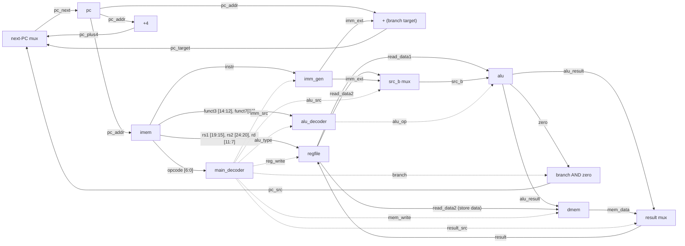

# RISC-V CPU (RV32I) in SystemVerilog

A RISC-V processor core designed from scratch in SystemVerilog and simulated with Verilator.

The core currently runs as a **single-cycle RV32I processor**: every instruction completes fetch, decode, execute, memory access, and write-back in one clock cycle. Each module was written and unit-tested on its own before being integrated, and the full CPU passes an integration test program that exercises every supported instruction.

**Next step:** convert the design into a 5-stage pipeline with hazard detection and forwarding.

---

## Status

| Phase | Description | Status |
|---|---|---|
| 1 | Toolchain and project setup | Completed |
| 2 | Datapath modules (PC, imem, regfile, ALU, imm_gen, dmem) | Completed |
| 3 | Control unit (main decoder + ALU decoder) | Completed |
| 4 | Single-cycle CPU integration + test program | Completed |
| 5 | 5-stage pipeline with forwarding, stalls, and flushes | In-Progress |
| 6 | Verification against the official `riscv-tests` suite | Planned |
| 7 | FPGA deployment | Planned |

## Supported instructions

| Type | Instructions |
|---|---|
| R-type (register-register) | `add`, `sub`, `and`, `or` |
| I-type (immediate / load) | `addi`, `lw` |
| S-type (store) | `sw` |
| B-type (branch) | `beq` |

---

## Architecture

Solid arrows carry data; dotted arrows are control signals from the decoders.



### How one instruction flows through: `lw x7, 8(x1)`

1. **Fetch:** the PC sends the current address to instruction memory, which outputs the 32-bit instruction.
2. **Decode:** the instruction's fields are wired out directly. The opcode goes to the main decoder, rs1 (x1) to the register file's read port, rd (x7) to its write port, and the whole instruction to the immediate generator. The main decoder recognizes a load and sets `alu_src = 1`, `result_src = 1`, `reg_write = 1`, `imm_src = I-type`, and selects add for the ALU.
3. **Execute:** the register file reads x1, the immediate generator sign-extends the offset 8, and the ALU adds them to produce the memory address.
4. **Memory:** data memory returns the word stored at that address.
5. **Write-back:** the result mux selects the memory data (`result_src = 1`), and on the clock edge it is written into x7. On the same edge, the PC loads PC + 4.

All five steps happen within a single clock cycle. That limitation, where the clock period must cover the slowest path through the whole datapath, is what pipelining addresses.

---

## Modules

| Module | File | Type | Description |
|---|---|---|---|
| CPU (top) | `rtl/cpu.sv` | Structural | Instantiates and wires all modules; contains the `src_b`, result, and next-PC muxes and the branch-target adder. |
| Program Counter | `rtl/pc.sv` | Sequential | 32-bit register holding the current instruction address. Resets to 0 and loads `pc_next` on each rising edge. |
| Instruction Memory | `rtl/imem.sv` | Combinational | 256-word ROM preloaded with the test program. Converts byte address to word index with `address[9:2]`. |
| Register File | `rtl/regfile.sv` | Mixed | 32 × 32-bit registers. Two combinational read ports, one clocked write port gated by `write_enable`. `x0` always reads 0. |
| Immediate Generator | `rtl/imm_gen.sv` | Combinational | Extracts and sign-extends I-, S-, and B-type immediates, reassembling the split S/B fields. |
| ALU | `rtl/alu.sv` | Combinational | Add, subtract, bitwise AND, bitwise OR, selected by `alu_op`. Outputs a `zero` flag for branches. |
| Data Memory | `rtl/dmem.sv` | Mixed | 256-word RAM. Combinational read, clocked write gated by `mem_write`, word-aligned addressing. |
| Main Decoder | `rtl/main_decoder.sv` | Combinational | Decodes the opcode into datapath control signals. Unknown opcodes default to "write nothing." |
| ALU Decoder | `rtl/alu_decoder.sv` | Combinational | Combines `alu_type` with funct3/funct7 to select the exact ALU operation. |

### Control signals

| Instruction | reg_write | imm_src | alu_src | mem_write | result_src | branch | alu_type |
|---|---|---|---|---|---|---|---|
| R-type | 1 | x | 0 | 0 | 0 | 0 | `10` (use funct) |
| `addi` | 1 | `00` (I) | 1 | 0 | 0 | 0 | `00` (add) |
| `lw` | 1 | `00` (I) | 1 | 0 | 1 | 0 | `00` (add) |
| `sw` | 0 | `01` (S) | 1 | 1 | x | 0 | `00` (add) |
| `beq` | 0 | `10` (B) | 0 | 0 | x | 1 | `01` (sub) |

`x` = don't care: the signal's consumer ignores it for that instruction. Write enables (`reg_write`, `mem_write`) are never don't-care.

### ALU operations

| `alu_op` | Operation | R-type encoding |
|---|---|---|
| `00` | add | funct3 `000`, funct7[5] = 0 |
| `01` | sub | funct3 `000`, funct7[5] = 1 |
| `10` | and | funct3 `111` |
| `11` | or | funct3 `110` |

---

## Verification

Every module has its own Verilator testbench in `tb/`. The immediate generator, data memory, and both decoders use self-checking testbenches that print `PASS` or `FAIL` for each case, including negative immediates, write-enable gating, and invalid opcodes.

### Integration test program

The full CPU runs this program (`rtl/imem.sv`), which uses every supported instruction:

| Addr | Instruction | Expected effect |
|---|---|---|
| `0x00` | `addi x1, x0, 5` | x1 = 5 |
| `0x04` | `addi x2, x0, 10` | x2 = 10 |
| `0x08` | `add x3, x1, x2` | x3 = 15 |
| `0x0C` | `sub x4, x2, x1` | x4 = 5 |
| `0x10` | `and x5, x1, x2` | x5 = 0 |
| `0x14` | `or x6, x1, x2` | x6 = 15 |
| `0x18` | `sw x3, 0(x0)` | mem[0] = 15 |
| `0x1C` | `lw x7, 0(x0)` | x7 = 15 |
| `0x20` | `beq x3, x7, 8` | equal, so branch to `0x28` |
| `0x24` | `addi x8, x0, 1` | **skipped**, so x8 stays 0 |
| `0x28` | `addi x9, x0, 7` | x9 = 7 |
| `0x2C` | `beq x0, x0, 0` | loop forever (halt) |

**Result:** all ten checks pass (x1–x9 and mem[0]). This confirms the ALU operations, immediates, register reads and writes, the store/load path through memory, and a taken branch.

---

## Design notes

- **Byte address vs. word index.** Memory is byte-addressed, but instructions and data words are 4 bytes, so both memories index with `address[9:2]`.
- **Hardwired `x0`.** Each register-file read port uses a mux that returns 0 when register 0 is selected.
- **Combinational reads, clocked writes.** Reads are combinational so a single-cycle instruction can read, compute, and write back within one clock. All state changes (PC, register file, data memory) happen on the rising edge and are gated by enables.
- **No combinational loops.** The next-PC logic feeds back through the PC register, so the clock edge breaks the cycle.
- **Latch avoidance.** Every combinational block assigns its outputs on every path, either through a `default` case or defaults at the top of the block. Clocked blocks intentionally omit `else`, because holding state is the desired behavior.
- **Split immediates.** RISC-V keeps the register fields at the same bit positions in every format, so registers can be read before decoding finishes. The cost is that S- and B-type immediates are split across the instruction and must be reassembled. The sign bit is always `instruction[31]`.
- **Safe decoding.** Unknown opcodes decode to `reg_write = 0` and `mem_write = 0`, so an invalid instruction cannot corrupt state.

---

## Running the simulations

**Requirements:** Verilator, GTKWave, and a C++ compiler. Developed on Ubuntu under WSL2.

### Full CPU

```bash
rm -rf obj_dir
verilator --cc --exe --build --trace --public-flat-rw --top-module cpu \
  rtl/cpu.sv rtl/pc.sv rtl/imem.sv rtl/main_decoder.sv rtl/alu_decoder.sv \
  rtl/regfile.sv rtl/imm_gen.sv rtl/alu.sv rtl/dmem.sv tb/cpu_tb.cpp
./obj_dir/Vcpu
gtkwave cpu.vcd   # optional: view the waveform
```

`--public-flat-rw` lets the testbench read the register file and data memory directly to check final state.

### Individual modules

```bash
verilator --cc --exe --build rtl/<module>.sv tb/<module>_tb.cpp
./obj_dir/V<module>
```

For example:

```bash
verilator --cc --exe --build rtl/alu.sv tb/alu_tb.cpp
./obj_dir/Valu
```

---

## Repository structure

```
rtl/    SystemVerilog source modules
tb/     Verilator C++ testbenches
```

## Roadmap

- **Pipeline:** split into IF / ID / EX / MEM / WB stages with pipeline registers.
- **Hazards:** forwarding unit for data hazards, stall logic for load-use hazards, flushing for taken branches.
- **Verification:** run the official `riscv-tests` suite; co-simulate against the Spike reference simulator.
- **FPGA:** synthesize and run on hardware, and report the maximum clock frequency.
- **Extensions:** branch prediction, an instruction cache, and a larger instruction subset.

## Reference

Harris & Harris, *Digital Design and Computer Architecture, RISC-V Edition*, Chapter 7.
